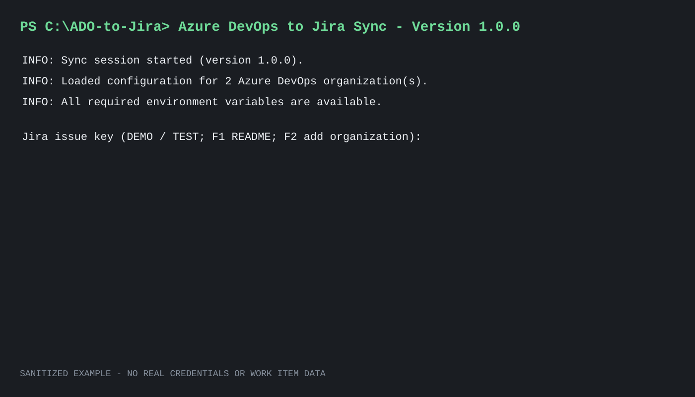
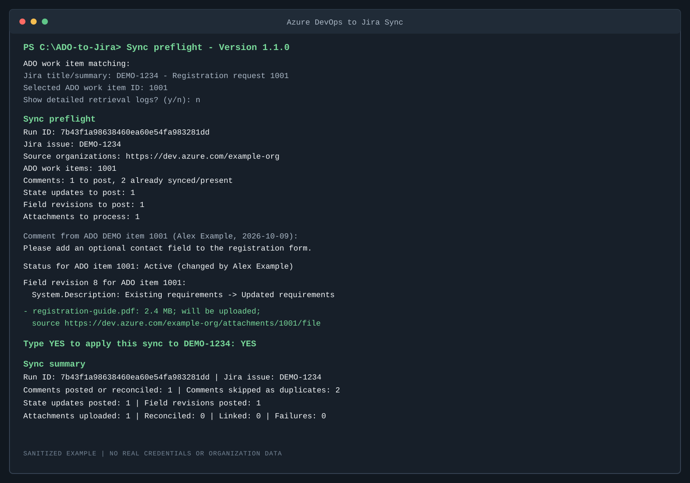
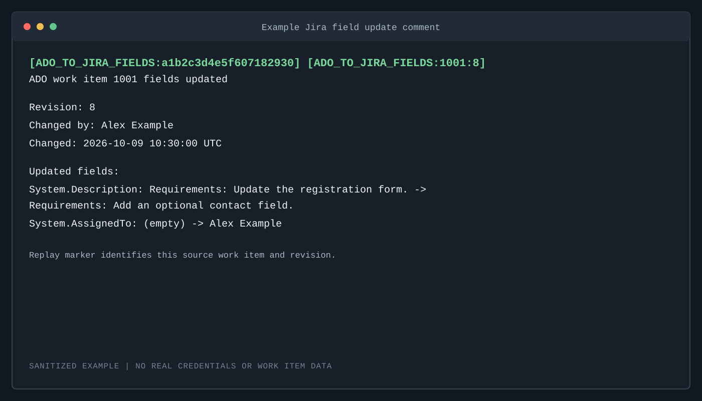

# Azure DevOps to Jira Sync

This project copies Azure DevOps work item comments and attachments into Jira issues.

## Repository layout

This repo is intentionally split into public-safe and local-only files:

- `clean_ado_to_jira_sync.py` - launcher-compatible CLI entry point
- `cli.py` - command-line startup and top-level error handling
- `config.py` - configuration, first-run setup, logging, and run-state persistence
- `ado_client.py` and `jira_client.py` - Azure DevOps and Jira API operations
- `transforms.py` - comment, attachment, and field-value transformations
- `models.py` - application configuration and shared runtime state
- `sync_service.py` - synchronization workflow and posting orchestration
- `config.example.json` - example configuration template
- `README.md` - public documentation
- `ADO to Jira Sync.cmd` - Windows launcher and Command Prompt fallback
- `ADO to Jira Sync.ps1` - preferred persistent PowerShell launcher
- `Update.cmd` and `Update.ps1` - update a checkout without replacing local configuration or runtime data
- `VERSION` - current application version
- `CHANGELOG.md` - user-visible changes by release
- `config.json` - local configuration file with your actual org URLs and Jira email

Keep the local working script and local config file off Git. The public repo should only contain the safe, shareable versions.

## Requirements

- Python 3.9 or newer
- Access to the Azure DevOps organizations you want to sync
- Jira Cloud access
- One Jira API token
- One Azure DevOps PAT per configured organization prefix

## Install dependencies

```powershell
python -m pip install -r requirements.txt
```

The dependency list is stored in `requirements.txt` next to the scripts.

Run the offline regression tests from the repository root with:

```powershell
python -m unittest discover -s ".\ADO to JIRA\tests"
```

## What the sync does

- Reads comments and attachments from Azure DevOps work items.
- Posts each work item's current state, last changed-by identity, and last changed timestamp into a Jira status comment.
- Posts a separate Jira comment with before-and-after values when non-status fields change in the latest Azure DevOps revision.
- Converts HTML comment content into readable Jira text.
- Uploads work item attachments and comment-linked screenshots to Jira.
- Streams attachment downloads and uploads instead of loading entire files into memory.
- Reuses one HTTP session per run for connection pooling.
- Stores a clickable Jira link when an attachment exceeds the configured size limit.
- Avoids reposting matching Jira comments and tracks attachment uploads by ADO source URL, so separate files with the same filename are not conflated.
- Supports multiple Azure DevOps organizations using configurable Jira prefixes.
- Writes the retrieved comments to `work_item_comments.csv` for review.

## Versioning

The current version is stored in the repository-root `VERSION` file and is shown in the startup log. Versions follow Semantic Versioning (`MAJOR.MINOR.PATCH`): increase MAJOR for incompatible changes, MINOR for backward-compatible features, and PATCH for backward-compatible fixes. Add user-visible changes to `CHANGELOG.md` under the matching version before releasing it.

## First-time setup

When you run the script for the first time, it will detect whether a configuration file is missing and prompt you to set it up.

The script asks for:

- how many Azure DevOps organizations you want to configure
- the Jira prefix for each organization, such as `MBSD` or `ONSD`
- the Azure DevOps URL for each organization
- the Jira base URL
- the Jira email address

It then creates a local `config.json` file next to the script.

Example format:

```json
{
	"ado_configs": {
		"MBSD": {
			"organization_url": "https://dev.azure.com/your-org"
		},
		"ONSD": {
			"organization_url": "https://dev.azure.com/another-org"
		}
	},
	"jira": {
		"base_url": "https://your-company.atlassian.net",
		"email": "you@example.com"
	}
}
```

The optional `max_attachment_size_mb` setting controls the upload limit. It defaults to `100` when omitted. Attachments larger than this limit are not uploaded; their Azure DevOps links are posted to Jira instead.

The organization prefix is used to build the expected environment variable name for that PAT.

Example:

- `MBSD` => `AZDO_MBSD_PAT`
- `ONSD` => `AZDO_ONSD_PAT`

## Add credentials to Windows

After creating or loading `config.json`, the script checks whether the required environment variables are available. If any are missing, it displays:

1. Press the Windows key and search for `environment variables`.
2. Open **Edit the system environment variables**.
3. Select **Environment Variables**.
4. Under User variables, select **New**.
5. Enter each missing variable name exactly as shown by the script.
6. Enter the matching Jira API token or Azure DevOps PAT as the value.
7. Select **OK** on each window to save the changes.
8. Close and reopen PowerShell, Command Prompt, or VS Code.

The script then asks whether it should open the Windows Environment Variables editor automatically. Answer `Y` or `yes` to open it, or `N` to open it yourself.

### Create a Jira API token

1. Open the [Atlassian API token page](https://id.atlassian.com/manage-profile/security/api-tokens).
2. Select **Create API token**.
3. Enter a label and create the token.
4. Copy the token immediately. Atlassian will not show it again.
5. Save it as `JIRA_API_TOKEN` in Windows environment variables.

### Create an Azure DevOps PAT

Create one PAT for each configured Azure DevOps organization:

1. Sign in to the Azure DevOps organization.
2. Select your profile icon, then **User settings** > **Personal access tokens**.
3. Select **New Token**, then enter a name and expiration date.
4. Choose the organization and grant the minimum **Work Items** read access needed by this tool.
5. Create the PAT and copy it immediately. Azure DevOps will not show it again.
6. Save it as `AZDO_<PREFIX>_PAT`, replacing `<PREFIX>` with the configured organization prefix.

For example, an organization configured with the prefix `MBSD` uses `AZDO_MBSD_PAT`.

Add these values in Windows as user or system environment variables:

- `JIRA_API_TOKEN` - your Jira API token
- `AZDO_<PREFIX>_PAT` - one PAT for each configured organization prefix

Example:

```powershell
$env:JIRA_API_TOKEN = "your-jira-token"
$env:AZDO_MBSD_PAT = "your-azure-devops-pat"
$env:AZDO_ONSD_PAT = "your-other-azure-devops-pat"
```

For a permanent setup, add the same values through the Windows Environment Variables UI:

1. Press the Windows key and search for `environment variables`.
2. Open **Edit the system environment variables**.
3. Select **Environment Variables**.
4. Choose **New** under User variables.
5. Add each variable name/value pair.
6. Select **OK** to save.
7. Close and reopen PowerShell, Command Prompt, or VS Code so the variables are available.

To check whether a variable exists without exposing its value:

```powershell
@("JIRA_API_TOKEN", "AZDO_MBSD_PAT", "AZDO_ONSD_PAT") | ForEach-Object {
	"$_ set: " + [bool](Get-Item "Env:$_" -ErrorAction SilentlyContinue)
}
```

Never put tokens directly in the script, `config.json`, or Git.

## Run the script

From the folder containing the script:

```powershell
python clean_ado_to_jira_sync.py
```

### Use the automatic Windows launcher

Double-click `ADO to Jira Sync.cmd` to launch the application. The launcher checks for updates automatically before the first sync run when Windows PowerShell is available, and falls back to a Command Prompt loop if it is not. The fallback displays that it skipped the update check. It:

- uses `powershell.exe` when it is available
- fast-forwards the current Git branch when updates are available and tracked files have no local edits
- refreshes Python dependencies only when `requirements.txt` changes or a previous dependency install did not complete
- prefers the repository virtual environment at `.venv\Scripts\python.exe` when available
- uses the shared `clean_ado_to_jira_sync.py` script
- keeps the console open after each run
- automatically starts the first prompt again after the run finishes
- preserves the previous run's console history instead of clearing the screen

You can also start it from PowerShell or Command Prompt:

```powershell
& ".\ADO to Jira Sync.cmd"
```

The launcher does not contain credentials. Tokens continue to come from Windows environment variables.

The script asks for the Jira issue key, then reads the Jira title/summary and automatically extracts the first standalone number with at least four digits as the ADO work item number. Titles such as `196236 - IRP-PRIO-INC000037757282 - Error message` and `BUG 522880 - MPI Registration` produce ADO IDs `196236` and `522880`; the embedded incident number in the first title is ignored. The console displays the Jira title/summary and selected ADO ID. If no four-or-more-digit number is found, the run stops instead of asking for a replacement ID. You can choose whether to show additional retrieval logs; the safety preflight is always shown. It identifies the target Jira issue and source organizations, lists the comments, status changes, field values, and attachment URLs/dispositions planned for posting, and warns about oversized, unknown-size, and very large text values. Large comments and field values are sent in full rather than silently truncated; Jira rejection is reported as a failed item. Type `YES` at the final prompt to apply the sync; any other response cancels without Jira changes.

Status comments use a hidden marker containing the work item ID, state, and changed timestamp. This prevents the same status version from being posted repeatedly while allowing a new Jira status comment when the ADO state changes.

Non-status field update comments include the Azure DevOps field names, previous and new values, revision, and editor. HTML field values such as descriptions are converted to readable plain text, and formatting-only changes that render identically are omitted. State and audit-only fields are omitted because status comments already cover state changes. The initial work item creation revision is not treated as a field update, and a work-item/revision marker prevents duplicate comments. The first sync checks the latest revision; later runs process new revisions incrementally and retry any revision left pending by a prior failure.

At the Jira issue-key prompt, press `F1` to display this README or `F2` to add an Azure DevOps organization. The `F2` flow asks for a Jira project-key prefix and Azure DevOps organization URL, then saves that mapping to the local `config.json` while retaining the existing Jira account settings. Add the new prefix's PAT to Windows as `AZDO_<PREFIX>_PAT` and restart the launcher so it can read the new environment variable. On non-Windows terminals, enter `F1` or `F2` as text instead of pressing the function key.

## Screenshots

These sanitized captures show the current version and workflow:







Setup and environment-variable examples are indexed in [screenshots/README.md](screenshots/README.md).

The CSV export is written next to the script as `work_item_comments.csv`.

## Local activity logs

Each script writes activity and error information to a local `logs` folder next to the script. The log file is named `activity.log` and rotates at midnight. The current file plus up to 89 previous daily files are retained, so logs are kept for no more than 90 daily files. Operational messages also appear in the console through the logging system, while prompts and interactive setup instructions remain direct user prompts.

Logs include setup events, retrieval counts, preview and cancellation decisions, upload/post results, and error details. Tokens, PAT values, and other credential values are never written to the logs. The `logs` folder is ignored by Git and should remain local.

Each script invocation also receives a short session ID and a run ID. Activity log lines include those IDs plus the Jira issue key, source organization, and ADO work-item IDs once known, making it possible to correlate the daily log with the ledger and JSON audit export.

The script keeps a local `run_state.json` with the latest status, target issue, work-item IDs, counts, and failures. A run with handled item failures ends as `completed_with_errors`; a `running` status after an interruption means the previous session did not finish normally. A local SQLite `sync_ledger.sqlite3` records source snapshots, event statuses, and target Jira IDs for replay-safe runs. Each run also exports decisions and an attachment source-URL-to-Jira-target mapping as `audit/sync-<run-id>.json`. These files contain synced work-item content and URLs, so keep the ignored runtime data local and access-controlled.

Set `failure_mode` in `config.json` to `continue` (the default) to record an item failure and continue, or `stop` to stop after the first item failure. Handled failures and reasons appear in the console summary, run state, and audit export. Shared HTTP-session requests and Azure DevOps SDK work-item reads retry transient 429/5xx responses; Jira writes use bounded retries and reconcile uncertain results before retrying.

## Security guidance

- Keep `config.json` local and do not commit it.
- Never commit PATs, API tokens, `.env` files, or generated CSV exports.
- Keep the public repo limited to safe shareable files.
- Rotate any credential that may have been exposed.
- Review the preflight and destination Jira issue before typing `YES` to apply the sync.

## Updating the app

When you start `ADO to Jira Sync.cmd`, it checks for updates before showing the first sync prompt. The console reports whether it is checking, updated, already current, or continuing after an update error. You do not need to run the updater separately. To check manually, run `ADO to JIRA/Update.cmd`.

The updater uses Git to fast-forward the current branch. It will not update if tracked files have local edits, and it never resets or stashes files. Resolve or commit those edits, then start the launcher again. Ignored configuration, logs, run state, and generated CSV files are not replaced.

The launcher runs the shared `clean_ado_to_jira_sync.py` file, so updates apply to everyone rather than being shadowed by a private `ado_to_jira_sync.py` copy. Dependencies are installed when `requirements.txt` changes or a previous install did not finish successfully. The updater uses the repository `.venv` when present, or the available Python installation otherwise; a failed install is retried at the next launcher start.

Git is required for update checks. If the check fails, the launcher displays a warning and continues with the current files. If Windows PowerShell is unavailable, the Command Prompt fallback displays that it skipped the update check. Python is needed when dependencies must be installed and to run the sync.
